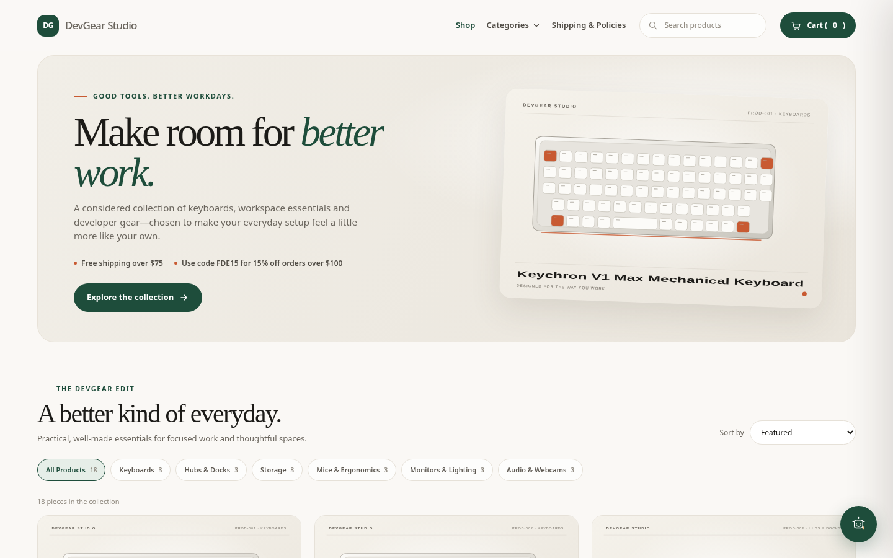
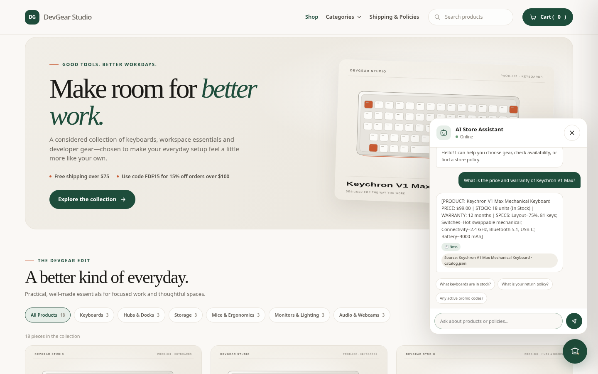
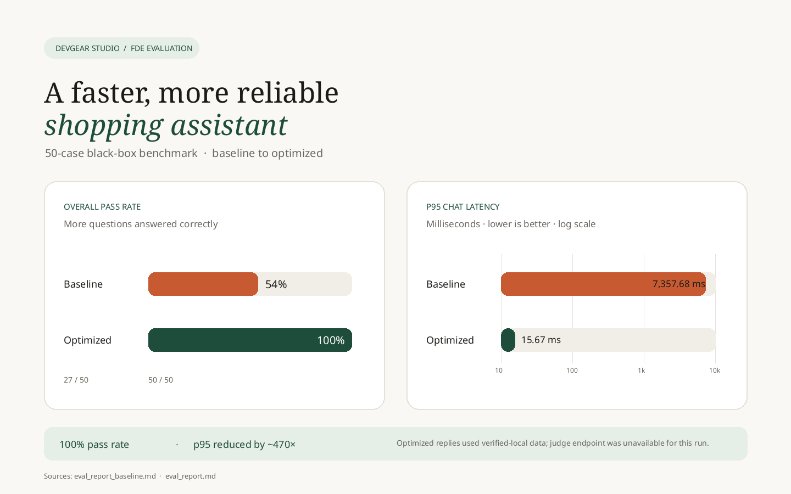
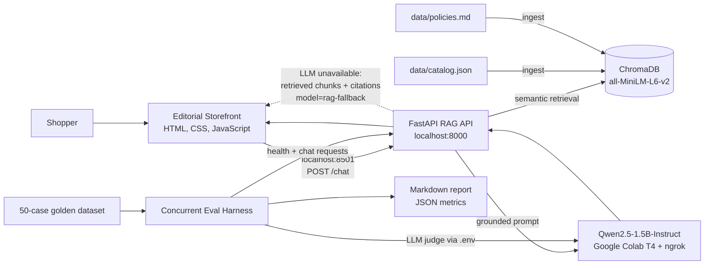

# DevGear Studio — RAG Storefront & Evaluation Harness

An end-to-end Forward-Deployed Engineer build: a warm editorial hardware storefront, a grounded product-and-policy assistant, a resilient FastAPI + ChromaDB RAG service, and a 50-case black-box evaluation harness.

## Product tour

### Storefront hero and catalog



*The cream editorial storefront pairs the free-shipping and FDE15 offer with category filters and the product catalog.*

### AI Store Assistant



*The floating assistant returns a verified product answer with latency and a catalog citation.*

### Evaluation benchmark



*The 50-case optimization run improved pass rate and p95 response latency; the chart notes the judge endpoint limitation.*

## Architecture



## Stack

- **Storefront:** responsive cream-editorial HTML/CSS/vanilla JavaScript, local product SVGs, multi-view routing, cart, and floating assistant.
- **API:** FastAPI with Pydantic request/response models and local-development CORS.
- **Retrieval:** persistent ChromaDB with its lightweight `all-MiniLM-L6-v2` ONNX embedding function, hybrid vector/keyword ranking, exact product-name and policy boosts, and structured product fact blocks; no PyTorch requirement.
- **Generation and judging:** OpenAI-compatible `Qwen/Qwen2.5-1.5B-Instruct` endpoint served from a Google Colab T4 runtime through ngrok.
- **LLM outage fallback:** if generation fails, `/chat` returns the top retrieved catalog or policy chunks with their citations and reports `model: "rag-fallback"` instead of failing the request.
- **Pre-LLM safety:** lightweight routing rejects prompt-injection and fake-price overrides before generation, alongside fast greetings and out-of-domain refusals.
- **Evaluation:** 50 catalog-grounded, policy, inventory, comparison, out-of-domain, and adversarial cases; concurrent requests; deterministic checks plus an LLM judge.
- **Fast verified paths:** exact catalog lookups/comparisons, policy FAQs and simple promo math, greetings, obvious out-of-domain questions, and prompt-injection/price-override attempts are handled from local verified data before the LLM call. Open-ended recommendations and questions use the LLM.

## Optimization results

The evaluation loop used [`data/golden_dataset.json`](data/golden_dataset.json) against the black-box `POST /chat` service. Baseline diagnostics identified failures in factual answers, stock handling, refusals, and response time; hybrid lexical/semantic retrieval, stronger guardrails, and verified-local responses addressed those cases.

| Run | Passed | Pass rate | p95 chat latency |
| --- | ---: | ---: | ---: |
| Baseline ([`eval_report_baseline.md`](eval_report_baseline.md)) | 27 / 50 | 54.00% | 7,357.68 ms |
| Optimized ([`eval_report.md`](eval_report.md)) | 50 / 50 | 100.00% | 15.67 ms |

The optimized run's 50 test replies used verified-local facts and deterministic pass gates. The configured LLM-judge endpoint returned errors for all 50 judge requests, so the harness recorded **0 LLM-judged responses and 50 deterministic fallbacks**; the reported 100% is not presented as an LLM-judge score. The optimized report and raw per-case metrics are available in [`eval_report.md`](eval_report.md) and [`eval_results.json`](eval_results.json).

## Quickstart

### 1. Configure the LLM endpoint

```bash
cp .env.example .env
```

Set `LLM_BASE_URL`, `LLM_API_KEY`, and `LLM_MODEL` in `.env` to match the active OpenAI-compatible Colab/ngrok endpoint. The checked-in example contains a placeholder API key. Start the model endpoint before expecting live generated answers.

### 2. Install dependencies and start the API

```bash
python -m venv .venv
source .venv/bin/activate
pip install -r requirements.txt
uvicorn backend.main:app --reload
```

The first startup may download the ONNX embedding model and ingest the catalog and policies into `./chroma_db`. Check `http://localhost:8000/health` for service status and indexed chunk count. The OpenAI-compatible model endpoint is configured separately in Google Colab; if it is unavailable, the API still responds from retrieved local context.

### 3. Serve the storefront

In another terminal, from the repository root:

```bash
python frontend/serve.py
```

Open `http://localhost:8501/frontend/index.html`.

### 4. Run the evaluation gate

With the API and configured judge endpoint available:

```bash
python eval/eval_harness.py \
  --backend-url http://localhost:8000 \
  --dataset data/golden_dataset.json \
  --concurrency 3 \
  --judge-mode hybrid \
  --min-pass-rate 80
```

For a quick subset:

```bash
python eval/eval_harness.py --limit 10 --judge-mode hybrid
```

The runner verifies `/health`, dispatches concurrent `/chat` requests, records each response, citation, status, and latency, then writes `eval_report.md` and `eval_results.json` in the project root. Its exit code is `0` when the configured minimum pass rate is met and `1` when it is not, making it suitable for a CI quality gate.

## Docker Compose

Configure the model endpoint once, then build and start the API and storefront:

```bash
cp .env.example .env
# Set LLM_BASE_URL, LLM_API_KEY, and LLM_MODEL in .env as needed.
docker compose up --build
```

Open the storefront at `http://localhost:8501/frontend/index.html`; the FastAPI health endpoint is at `http://localhost:8000/health`. The backend stores its persistent ChromaDB index in the host `./chroma_db` directory. The image runs as a non-root user (UID/GID 1000 by default); on Linux systems with different workspace ownership, pass matching IDs at build time:

```bash
APP_UID="$(id -u)" APP_GID="$(id -g)" docker compose up --build
```

With the backend available, run the on-demand, concurrency-1 evaluation profile:

```bash
docker compose --profile eval run --rm eval
```

The evaluation container mounts the workspace so `eval_report.md` and `eval_results.json` are written back to the host. Stop the application with `docker compose down`; the bind-mounted ChromaDB data remains in `./chroma_db`.

## Evaluation behavior

- `--judge-mode hybrid` requires deterministic checks and a passing LLM judge verdict for generated answers. Verified-local answers are gated by their exact required/forbidden checks; clear expected refusals are also determined by the refusal guard rather than the judge's semantic preference.
- `--judge-mode llm` allows the judge to recognize valid paraphrases that miss literal `must_include` strings; deterministic forbidden-content and refusal guardrails remain mandatory.
- If the judge endpoint is unavailable, returns an HTTP error, times out, or returns an invalid response, the runner records the error and falls back to deterministic grading.
- `--concurrency` sets the number of simultaneous backend requests. `--limit` runs the first N dataset cases; `--min-pass-rate`, `--request-timeout`, and `--judge-timeout` are configurable.
- The report includes total and category pass rates, inventory/adversarial guardrail block rate, p50/p95/maximum request latency, throughput, and per-case failure diagnostics. Raw per-case data and judge provenance are retained in JSON.

## Repository structure

```text
Dockerfile           Slim Python 3.12 image; app runs as a non-root user
compose.yaml         Backend, storefront, and on-demand evaluation services
.dockerignore        Excludes secrets, caches, and the local ChromaDB index
backend/             FastAPI service and ChromaDB RAG implementation
data/catalog.json    18 structured product records
data/policies.md     Store shipping, returns, warranty, and promo policies
data/golden_dataset.json  50 ground-truth evaluation cases
eval/eval_harness.py Concurrent black-box runner, deterministic checks, LLM judge
frontend/            Cream editorial storefront, local assets, static server
docs/screenshots/    Storefront, assistant, and benchmark screenshots
eval_report*.md      Baseline and optimized evaluation reports
eval_results*.json   Raw evaluation metrics and per-case results
```
